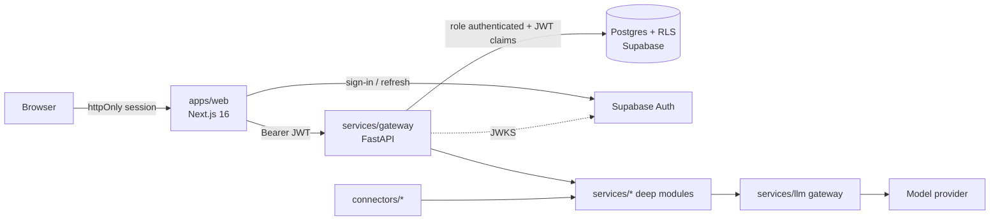

# QazSupply AI

[](https://github.com/AyanbergenSaduakassov07/QazSupply/actions/workflows/ci.yml)

AI procurement, supplier-vetting and shipment-control platform for Kazakhstan and Central Asia.

> **Status (2026-10-12):** M0-M3 are built and run end to end on synthetic data: upload -> matching -> findings -> human review -> released report + PDF -> cited Ask. Nothing is deployed and only M0 is merged to `main` (M1-M3 wait in PRs #1-#5). M4 (Supplier 360, screening, onboarding) is built on invented sample sources by owner override; Gate A (real data, paid audits) is still open. See [Project status](#project-status) below, the live tracker [`docs/prompts/PROGRESS.md`](docs/prompts/PROGRESS.md), and [`CHANGELOG.md`](CHANGELOG.md).

## What it is

Three products on one platform:

1. **Spend X-ray (the auditor):** upload purchase history, get evidence-backed findings on overpaying, split purchases and supplier concentration. A human expert reviews every report before the client sees it.
2. **Supplier 360 and Procurement OS (the detective):** supplier dossiers, sanctions and beneficial-owner screening, RFQs, offer comparison, technical-spec checks, catalogue with analogs.
3. **Logistics Control Tower and Risk Radar:** multi-source shipment tracking, probabilistic ETA, border-queue forecasts, reroute options, and alerts linked to your suppliers and orders.

## Non-negotiable principles

1. SQL and Python compute every number. The LLM reads text, extracts fields and explains. No figure without an Evidence id.
2. AI prepares and flags; a human decides and signs.
3. Only legal and open data sources, or sources with a recorded licence.
4. Multi-tenant by design: row-level security on every table, each policy tested.
5. All external text (supplier files, news, emails, PDFs) is untrusted.

Full rules: [`CLAUDE.md`](CLAUDE.md). Vocabulary: [`CONTEXT.md`](CONTEXT.md). How to contribute: [`CONTRIBUTING.md`](CONTRIBUTING.md).

## Architecture at a glance



- **Modular monolith** (ADR 0001): one Python deployable; modules talk only through `services.<module>.api` (enforced by a test).
- **Tenant isolation in the database** (ADR 0002): RLS on every table; the API runs every query as the signed-in user, so a bug in the API cannot read another tenant's rows.
- **LLM behind a gateway** (ADR 0004): redaction, budgets, kill switch, ledger. Models never produce figures.
- Deeper: [`docs/architecture/`](docs/architecture/) and [`docs/adr/`](docs/adr/README.md).

## Project status

### Phases
| Phase | State |
|---|---|
| M0 Foundation and blueprint | Done, merged. Gate: owner review of `CONTEXT.md` pending |
| M1 Data platform, design system, app shell | Built (PR #1) |
| M2 Spend X-ray engine | Built; gate **blocked**: needs real ЕНС ТРУ data, 300 owner-labelled lines, 2 hand-audited datasets |
| M3 Review gate, client report + PDF, Ask | Built (PR #5); open: live Ask citation coverage re-run (free-tier quota) |
| M4 Supplier 360, screening, onboarding | In progress on sample data (owner override before Gate A); real sources and real decisions open |
| M5-M9 | Not started |

### What it can do today (local, synthetic data)
- **Upload** purchase exports (CSV/XLSX in ru/kk/en formats) with plain-language row errors. Macro files, zip bombs and duplicate uploads are refused.
- **Normalise:** match items to the classifier (synthetic sample until real ЕНС ТРУ access), convert to KZT at National Bank rates, and resolve suppliers by BIN. A keyboard review queue handles unsure matches.
- **Find savings** with five deterministic detectors (overpaying, repeat purchases, split purchases, supplier concentration, outliers). Every amount is recomputed by an independent SQL check, and every finding links to its source rows.
- **Human review gate:** a reviewer decides on every finding, then approves and releases. Clients never see anything before release. The database enforces this and logs every step, with an optional two-person rule.
- **Client report:** every figure opens its evidence and shows who reviewed it. The PDF has identical figures in kk/ru/en.
- **Ask:** questions about a released report. Every number is checked against what it cites before display, and the designed refusal is "I can't answer that from your data". Off until the client opts in.
- Tenant isolation in the database, a tamper-evident audit log, three languages, light/dark themes, phone to desktop, accessibility 96-100.

### What it cannot do yet
Real data sources (ЕНС ТРУ, goszakup, sanctions), Supplier 360, RFQs, logistics and finance (M4-M8); a production AI model (the dev demo uses a free model or a local stand-in); deployment (no remote Supabase project yet); Kazakh copy is not yet reviewed by a native speaker.

### Needed from the owner
1. Merge PRs #1 -> #2 -> #3 -> #4 -> #5 (squash; the agent rebases the next one after each merge). In PR #4, confirm or refuse the OFL licence exception for the PDF font (IBM Plex).
2. Free tier only for now (owner, 2026-10-12): the live Ask eval runs in slices under OpenRouter's 50 free requests/day. Later, a production model key and a DPA with that provider.
3. Send the ЕНС ТРУ / goszakup access request (draft in [`docs/runbooks/m2-gate-data.md`](docs/runbooks/m2-gate-data.md)).
4. **Gate A evidence:** 300 hand-labelled purchase lines; 2 real spend exports with every finding marked correct or wrong (precision >= 80%); 3 paid audits run through the product.
5. Before the first real client: a remote Supabase project, a native Kazakh review of the UI copy, and a GitHub plan for branch protection.

### Next prompts and what each needs from you
| Prompt | Starts after | You provide |
|---|---|---|
| M4 Supplier 360 + compliance | Gate A | goszakup OWS token + terms, data.egov.kz access, an OpenSanctions licence quote, counsel's view on beneficial-owner data |
| M5 Procurement OS (RFQ, ТЗ checker, catalogue) | M4 | Suppliers who answer RFQs. **Gate B:** 5+ real decisions, 20+ RFQs, a measured cycle-time drop |
| M6 Logistics core | Gate B | Two real tracking sources with terms; 50 shipments |
| M7 Predict and Protect (ETA, borders, risk radar) | M6 | 50+ live shipments; your feedback on alerts (**Gate C**) |
| M8 Network and Finance | Gate C | **Written legal advice before any code**; partner banks/insurers for a sandbox |
| M9 Region, scale, hardening | M8 | A second country and pilot client; a restore-drill window; an external security test budget |

The full checklist, marked **[you]** / **[agent]** / **[both]**, is in [`docs/prompts/PROGRESS.md`](docs/prompts/PROGRESS.md#action-list-what-is-left-who-does-it-updated-2026-10-12). To continue the build in a new session: `Read docs/prompts/RUN-NEXT.md and continue.`

### See the demo yourself
```bash
pnpm demo            # everything with demo data; opens http://localhost:3000
pnpm demo --fresh    # from a clean database
pnpm demo --ai       # Ask uses the real free model (OPENROUTER_API_KEY in .env.local)
```
| Who | Login | Try |
|---|---|---|
| Client admin (Org B) | `b.admin@qazsupply.test` | Findings -> the released report: evidence drawer, Download PDF, Ask; Uploads; Settings -> Ask switch |
| Reviewer | `reviewer@qazsupply.test` | Findings -> the draft: Submit, then decide each finding with J/K/A/E/R, Approve, Release |
| Others | `a.admin@`, `a.user@`, `qs.admin@qazsupply.test` | Org A view, client user, QazSupply admin (two-person rule switch) |

The shared local password is printed by `pnpm demo` (and is in `e2e/fixtures/users.json`; local test users only). Ctrl+C stops the app; the database keeps running: `supabase --workdir infra stop` stops it.

## Quickstart

Needs Node 24 (`.nvmrc`; corepack provides pnpm), [uv](https://docs.astral.sh/uv/), Docker, Supabase CLI.

```bash
pnpm demo         # the full product with demo data: opens http://localhost:3000, prints the logins
pnpm demo --fresh # same, starting from a clean database
make dev          # plain development: install, start local Supabase (seeded), run web :3000 + API :8000
```

`pnpm demo` starts Docker if needed, the local database, the API and the web app. It then loads a released report (30 findings, one rejected, one with a reviewer note), switches Ask on, and leaves a second report as a draft for the reviewer. Ctrl+C stops it. Ask answers with a deterministic local stand-in; add `--ai` to use the real free model (`OPENROUTER_API_KEY` in `.env.local`).

Open http://localhost:3000 and sign in with a seeded test user from `e2e/fixtures/users.json` (local only).

| Command | What it runs |
|---|---|
| `make help` | List the targets below |
| `pnpm demo` / `make demo` | Full local demo with data (see above) |
| `make check` | Biome lint, TS + mypy typecheck, unit + contract tests |
| `make rls` | pgTAP suites (RLS, roles, append-only, tamper detection), Supabase advisor lints, API isolation tests |
| `make e2e` | Playwright on desktop, tablet and phone (auth, tenant isolation through the UI, a11y, CSP) |
| `make visual` | Visual baselines (3 screens x 3 viewports x 2 themes x 3 languages) in the Linux Playwright image |
| `make lighthouse` | Lighthouse accessibility gate (>= 95) |

## Repository layout

```text
QazSupply/
├─ apps/web/             Next.js client app (shell, sign-in, settings, audit, spend upload/review/findings)
├─ packages/
│  ├─ agent-skills/      plan for in-product agent skills and MCP tools (built M3, published M9)
│  ├─ api-client/        typed client generated from the API's OpenAPI (CI checks drift)
│  ├─ design-tokens/     3-layer tokens, light/dark, contrast-tested
│  ├─ i18n/              kk / ru / en catalogs (key parity + Kazakh orthography tested)
│  ├─ motion/            anime.js v4 presets, reduced-motion safe
│  └─ ui/                components (Evidence drawer, data table, charts, ...)
├─ services/             Python deep modules (ingest, normalize, analyze, evidence, ...); gateway = HTTP edge
├─ connectors/           one adapter per external source: enstru (mock), fx (NBK); contract in _contract/
├─ infra/supabase/       migrations, seed (local only), pgTAP tests
├─ e2e/                  Playwright suites and visual baselines
├─ evals/                synthetic golden sets, scorers and phase eval reports
├─ scripts/              advisors, licence gate, visual + Lighthouse runners, vendoring
├─ vendor/               pinned third-party source (licence-tracked)
├─ docs/                 ADRs, architecture, specs, tickets, design, security, compliance
└─ .github/              CI, CODEOWNERS, Dependabot, PR and issue templates, ruleset
```

Every module has a `README.md` stating its purpose and public interface. Folders exist only once a phase builds them; planned modules are mapped in [`docs/architecture/domain-model.md`](docs/architecture/domain-model.md). Documentation map: [`docs/README.md`](docs/README.md).

## Quality gates (CI, all required)

`lint` · `typecheck` (+ api-client drift) · `unit` · `contract` (+ vendor check) · `rls` (pgTAP, advisors, API isolation on real Supabase) · `e2e` (functional, visual, Lighthouse) · `security-scan` (gitleaks on full history, OSV, SBOM) · `license-scan`.

Dependencies are exact-pinned and at least 14 days old (pnpm release-age gate; Dependabot cooldown). Actions are pinned to commit SHAs.

## Open-source building blocks

226 GitHub repos verified on 2026-10-08 and mapped to the prompts that use them: [`docs/research/oss-catalog.md`](docs/research/oss-catalog.md). Licence policy and register: [`docs/compliance/third-party-licenses.md`](docs/compliance/third-party-licenses.md).

## Security and confidentiality

Proprietary ([`LICENSE`](LICENSE)). Report vulnerabilities privately: [`SECURITY.md`](SECURITY.md). Never commit real client data, keys or credentials; `.env.example` lists variable names only.
