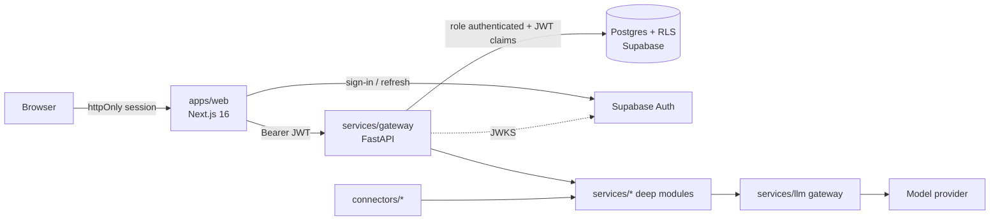

# QazSupply AI

[](https://github.com/AyanbergenSaduakassov07/QazSupply/actions/workflows/ci.yml)

AI procurement, supplier-vetting and shipment-control platform for Kazakhstan and Central Asia.

> **Status:** M0 (harness + blueprint), M1 (multi-tenant data platform, design system, app shell) and the M2 Spend X-ray engine (ingest, matching, FX, review queue, detectors with Evidence) are built on synthetic data. The M2 gate is **blocked** until real ЕНС ТРУ access, 300 owner-labelled lines and two hand-audited datasets exist; see [`docs/prompts/PROGRESS.md`](docs/prompts/PROGRESS.md) and [`evals/REPORT-M2.md`](evals/REPORT-M2.md). History: [`CHANGELOG.md`](CHANGELOG.md).

## What it is

Three products on one platform:

1. **Spend X-ray (the auditor):** upload purchase history, get evidence-backed findings on overpaying, split purchases and supplier concentration. A human expert reviews every report before the client sees it.
2. **Supplier 360 and Procurement OS (the detective):** supplier dossiers, sanctions and beneficial-owner screening, RFQs, offer comparison, technical-spec checks, catalogue with analogs.
3. **Logistics Control Tower and Risk Radar:** multi-source shipment tracking, probabilistic ETA, border-queue forecasts, reroute options, and alerts linked to your suppliers and orders.

## Non-negotiable principles

1. SQL and Python compute every number. The LLM reads text, extracts fields and explains. No figure without an Evidence id.
2. AI prepares and flags; a human decides and signs.
3. Only legal and open data sources, or sources with a recorded licence.
4. Multi-tenant by design: row-level security on every table, each policy tested.
5. All external text (supplier files, news, emails, PDFs) is untrusted.

Full rules: [`CLAUDE.md`](CLAUDE.md). Vocabulary: [`CONTEXT.md`](CONTEXT.md). How to contribute: [`CONTRIBUTING.md`](CONTRIBUTING.md).

## Architecture at a glance



- **Modular monolith** (ADR 0001): one Python deployable; modules talk only through `services.<module>.api` (enforced by a test).
- **Tenant isolation in the database** (ADR 0002): RLS on every table; the API runs every query as the signed-in user, so a bug in the API cannot read another tenant's rows.
- **LLM behind a gateway** (ADR 0004): redaction, budgets, kill switch, ledger. Models never produce figures.
- Deeper: [`docs/architecture/`](docs/architecture/) and [`docs/adr/`](docs/adr/README.md).

## Quickstart

Needs Node 24 (`.nvmrc`; corepack provides pnpm), [uv](https://docs.astral.sh/uv/), Docker, Supabase CLI.

```bash
make dev          # install, start local Supabase (seeded), run web :3000 + API :8000
```

Open http://localhost:3000 and sign in with a seeded test user from `e2e/fixtures/users.json` (local only).

| Command | What it runs |
|---|---|
| `make help` | List the targets below |
| `make check` | Biome lint, TS + mypy typecheck, unit + contract tests |
| `make rls` | pgTAP suites (RLS, roles, append-only, tamper detection), Supabase advisor lints, API isolation tests |
| `make e2e` | Playwright on desktop, tablet and phone (auth, tenant isolation through the UI, a11y, CSP) |
| `make visual` | Visual baselines (3 screens x 3 viewports x 2 themes x 3 languages) in the Linux Playwright image |
| `make lighthouse` | Lighthouse accessibility gate (>= 95) |

## Repository layout

```text
QazSupply/
├─ apps/web/             Next.js client app (shell, sign-in, settings, audit, spend upload/review/findings)
├─ apps/{review,supplier-portal,marketing}/   planned (M3, M8)
├─ packages/
│  ├─ api-client/        typed client generated from the API's OpenAPI (CI checks drift)
│  ├─ design-tokens/     3-layer tokens, light/dark, contrast-tested
│  ├─ i18n/              kk / ru / en catalogs (key parity + Kazakh orthography tested)
│  ├─ motion/            anime.js v4 presets, reduced-motion safe
│  └─ ui/                components (Evidence drawer, data table, charts, ...)
├─ services/             Python deep modules (ingest, normalize, analyze, evidence, ...); gateway = HTTP edge
├─ connectors/           one adapter per external source (contract in _contract/)
├─ infra/supabase/       migrations, seed (local only), pgTAP tests
├─ e2e/                  Playwright suites and visual baselines
├─ evals/                synthetic golden sets, scorers and phase eval reports
├─ scripts/              advisors, licence gate, visual + Lighthouse runners, vendoring
├─ vendor/               pinned third-party source (licence-tracked)
├─ docs/                 ADRs, architecture, specs, tickets, design, security, compliance
└─ .github/              CI, CODEOWNERS, Dependabot, PR and issue templates, ruleset
```

Every folder has a `README.md` stating its purpose and public interface. Documentation map: [`docs/README.md`](docs/README.md).

## Quality gates (CI, all required)

`lint` · `typecheck` (+ api-client drift) · `unit` · `contract` (+ vendor check) · `rls` (pgTAP, advisors, API isolation on real Supabase) · `e2e` (functional, visual, Lighthouse) · `security-scan` (gitleaks on full history, OSV, SBOM) · `license-scan`.

Dependencies are exact-pinned and at least 14 days old (pnpm release-age gate; Dependabot cooldown). Actions are pinned to commit SHAs.

## Open-source building blocks

226 GitHub repos verified on 2026-10-08 and mapped to the prompts that use them: [`docs/research/oss-catalog.md`](docs/research/oss-catalog.md). Licence policy and register: [`docs/compliance/third-party-licenses.md`](docs/compliance/third-party-licenses.md).

## Security and confidentiality

Proprietary ([`LICENSE`](LICENSE)). Report vulnerabilities privately: [`SECURITY.md`](SECURITY.md). Never commit real client data, keys or credentials; `.env.example` lists variable names only.
