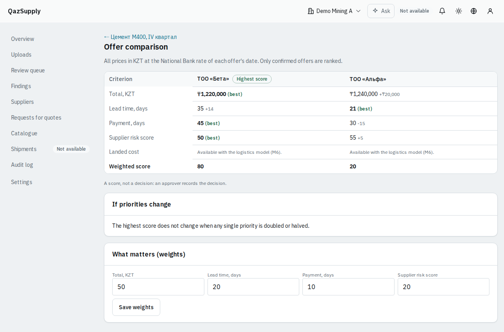
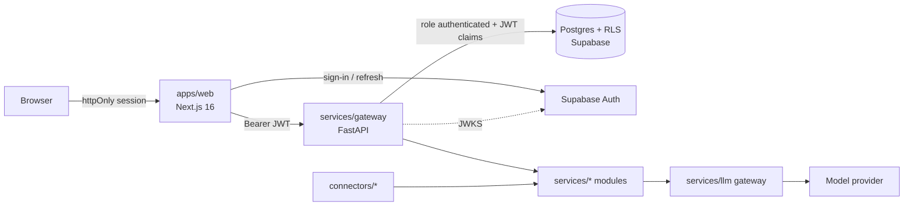

# QazSupply

AI-assisted procurement, supplier vetting and spend analysis for Kazakhstan and Central Asia, built as a multi-tenant monorepo (Next.js, FastAPI, Postgres with row-level security).

> **Status: prototype.** Everything runs locally on synthetic data. Nothing is deployed, there is no production model key, and the Kazakh classifier (ЕНС ТРУ), goszakup and sanctions sources are replaced by invented samples. Milestones M0-M5 are built; logistics, risk radar and finance (M6-M8) are not.



## Why I built it

Procurement teams in Kazakhstan buy in tenge and in several languages (kk, ru, en), against classifiers, registries and sanctions lists that are fragmented and mostly not API-accessible. I wanted to test one idea end to end: an AI system that reads text and drafts, while SQL and Python compute every number and a human signs every decision. The repo is that experiment, built milestone by milestone: spend audit, supplier dossiers, then RFQs and offer comparison.

## Features

Built and covered by tests, on synthetic data:

- **Spend X-ray (M1-M3):** upload CSV/XLSX purchase history, match items to a classifier, convert to KZT at National Bank rates, run five deterministic detectors (overpaying, repeat purchases, split purchases, supplier concentration, outliers). Every amount is recomputed by an independent SQL check; every figure opens its evidence. A reviewer approves findings before a client sees a report; PDF export in kk/ru/en.
- **Ask:** cited Q&A over a released report; numbers are validated against the cited findings before display. Off by default per organisation.
- **Supplier 360 (M4):** dossiers, sanctions and beneficial-owner screening, supplier onboarding with documents, on invented sample sources.
- **Procurement OS (M5):** RFQ lifecycle enforced in the database (approval, "sent" recorded by a person, append-only offers, supplier or buyer confirmation), a rules-only technical-spec (ТЗ) checker, a KZT offer-comparison engine with weighted score and sensitivity analysis, a catalogue with analog suggestions, and a decision memo PDF. The system never contacts suppliers by itself and never awards automatically.
- **Platform:** Postgres row-level security on every table, tamper-evident audit log, LLM gateway (redaction, budget, kill switch, ledger), read-only MCP tools at `/mcp/`, three UI languages, light/dark themes.

Not built: shipment tracking, ETA prediction, risk radar, marketplace and finance modules (specs only, in `docs/specs/`).

## Architecture



- Modular monolith (ADR 0001): modules talk only through `services.<module>.api`, enforced by a test.
- Tenant isolation in the database (ADR 0002): the API runs every query as the signed-in user, so an API bug cannot read another tenant's rows.
- Models never produce figures (ADR 0004).
- More: [`docs/architecture/`](docs/architecture/), [`docs/adr/`](docs/adr/README.md), [`docs/README.md`](docs/README.md).

## Tech stack

TypeScript, Next.js 16, React, anime.js; Python 3.13, FastAPI, psycopg, rapidfuzz, openpyxl; Postgres via Supabase (local), pgTAP; pnpm + turbo, uv; Biome, ruff, mypy (strict), pytest + Hypothesis, Playwright.

## Quickstart

Needs Node 24 (`.nvmrc`; corepack provides pnpm), [uv](https://docs.astral.sh/uv/), Docker and the Supabase CLI.

```bash
pnpm demo          # local Supabase + API + web with demo data; opens http://localhost:3000
pnpm demo --fresh  # same, from a clean database
make dev           # plain development: install, seeded local Supabase, web :3000 + API :8000
```

Demo users are local test accounts listed in `e2e/fixtures/users.json`; `pnpm demo` prints the shared password. Ask uses a deterministic local stand-in unless you pass `--ai` and set `OPENROUTER_API_KEY`.

## Configuration

Copy `.env.example`; it lists names only.

| Variable | Purpose |
|---|---|
| `APP_ENV`, `APP_URL`, `API_URL` | Environment and public URLs |
| `SUPABASE_URL`, `SUPABASE_ANON_KEY`, `SUPABASE_SERVICE_ROLE_KEY`, `DATABASE_URL` | Supabase / Postgres connection |
| `ANTHROPIC_API_KEY`, `LLM_MONTHLY_BUDGET_USD`, `LLM_KILL_SWITCH` | LLM gateway (provider adapter not built yet; dev uses OpenRouter free models) |
| `GOSZAKUP_API_TOKEN`, `OPENSANCTIONS_API_KEY` | Real data sources, only after a licence is recorded in `docs/compliance/data-sources.md` |
| `SENTRY_DSN` | Optional error reporting |

## Testing

```bash
make check      # Biome, tsc, ruff, mypy, unit + contract tests
make rls        # resets the LOCAL database; pgTAP, advisor lints, API integration tests
make e2e        # Playwright on desktop, tablet and phone
```

Last verified run (2026-11-16): Biome clean, 5 TypeScript typechecks, ruff and mypy (149 files) clean, 140 Python unit tests, 26 contract tests, 52 integration tests, 349 pgTAP assertions, 4 web unit tests, production web build. Playwright e2e and visual baselines were not re-run for this release.

## Project structure

```text
apps/web/            Next.js client app
packages/            ui, i18n, design-tokens, motion, api-client (generated), agent-skills
services/            Python modules (ingest, normalize, analyze, evidence, report, ask,
                     supplier360, procurement, llm, tenancy); gateway = HTTP edge
connectors/          one adapter per external source (samples today); contract in _contract/
infra/supabase/      migrations, local seed, pgTAP tests
e2e/                 Playwright suites and visual baselines
evals/               golden sets, scorers and per-milestone eval reports
scripts/             demo, advisors, licence gate, vendoring
docs/                ADRs, architecture, specs, design, security, compliance, glossary
```

## Status and limitations

- Synthetic data only. The classifier is a sample (`SYN-*` codes), supplier registries and sanctions lists are invented, and no real client data has been used.
- The matcher and finding-precision gates (matcher top-1 >= 90%, finding precision >= 80%) are not evaluated: they need real labelled data. Eval reports in `evals/` state what their numbers do and do not show; the ТЗ-checker holdout recall is 0.71.
- No production model: the Anthropic provider adapter is not built (`docs/tech-debt.md`, D11).
- Not deployed; no remote Supabase project. Kazakh UI copy has not been reviewed by a native speaker.
- Logistics, ETA and risk radar (M6-M7) and finance (M8) are not started.
- CI does not run Playwright or the visual baselines; run them locally.
- Next.js is pinned to 16.4.6 because 16.4.0 carries published advisories.
- Known shortcuts are tracked in [`docs/tech-debt.md`](docs/tech-debt.md).

## Credits

Third-party licences and the dependency register: [`THIRD_PARTY_NOTICES.md`](THIRD_PARTY_NOTICES.md), [`docs/compliance/third-party-licenses.md`](docs/compliance/third-party-licenses.md). The PDF font is IBM Plex (OFL-1.1). A survey of open-source building blocks is in [`docs/research/oss-catalog.md`](docs/research/oss-catalog.md). Exchange rates come from National Bank of Kazakhstan public data.

## Licence

[MIT](LICENSE). Report vulnerabilities privately: [`SECURITY.md`](SECURITY.md).
