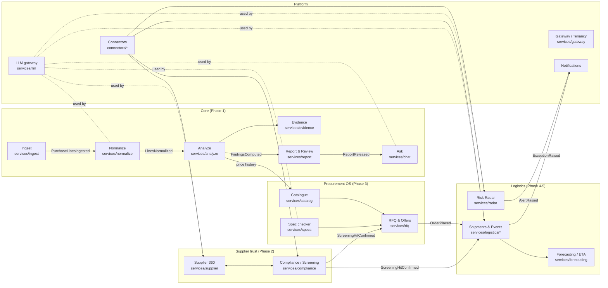
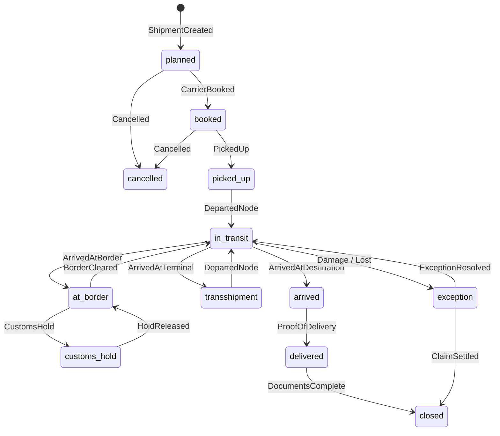
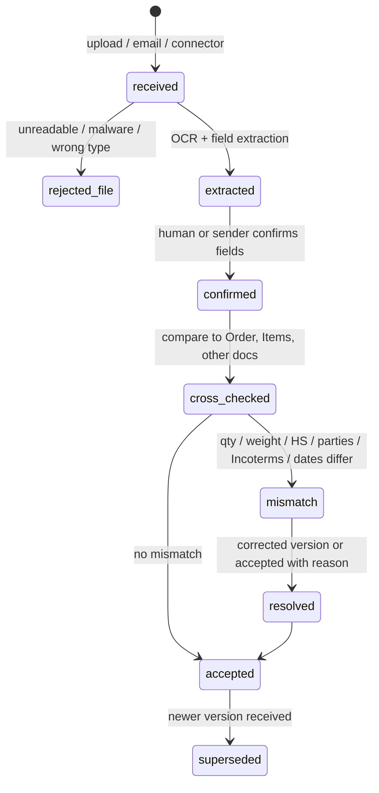
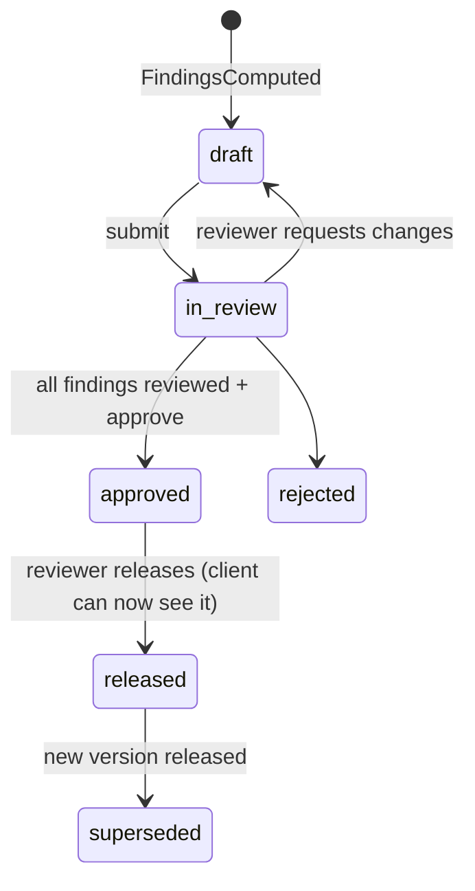

# Domain model: bounded contexts, events, state machines

Status: M0 proposal (2026-10-08). Terms: `CONTEXT.md`. Miro mirror: see link at the end. Each context is a deep module under `services/` (ADR 0001); contexts talk through their public interface or domain events, never through each other's tables.

## Bounded contexts

Relationship types: Ingest -> Normalize -> Analyze is a pipeline (customer/supplier). Connectors are an anti-corruption layer for every external source. Compliance is a shared kernel for Party/Screening used by Supplier 360, RFQ and Logistics. The LLM gateway is a generic subdomain: no context calls a model API directly.

## Domain events (past tense, append-only, carry `org_id`)

| Context | Event | Key payload | Consumers |
|---|---|---|---|
| Ingest | `UploadReceived` | upload_id, sha256, rows | Ingest |
| Ingest | `PurchaseLinesIngested` | upload_id, valid_rows, rejected_rows | Normalize |
| Normalize | `LineMatched` / `LineSentToReview` | line_id, item_code, confidence, method | Analyze, review queue |
| Normalize | `MatchConfirmedByHuman` | line_id, item_code, reviewer | Analyze, evals |
| Normalize | `SupplierResolved` / `SuppliersMerged` / `SupplierMergeReverted` | supplier ids, BIN | Supplier 360 |
| Analyze | `FindingsComputed` | run_id, detector versions, finding ids | Report |
| Report | `ReportSubmittedForReview` / `FindingReviewed` / `ReportApproved` / `ReportReleased` / `ReportRejected` | report_id, version, reviewer | Ask, notifications, audit |
| Compliance | `PartyScreened` | party_id, source_version, result | Supplier 360 |
| Compliance | `ScreeningHitConfirmed` / `ScreeningHitDismissed` | party_id, reason_code, reviewer | RFQ, Logistics, Alerts |
| Supplier | `SupplierInvited` / `OnboardingSubmitted` / `SupplierApproved` | supplier_id | RFQ, portal |
| RFQ | `RfqApproved` / `RfqSent` / `OfferReceived` / `OfferConfirmed` / `DecisionRecorded` | rfq_id, version | Catalogue, Orders |
| Orders | `OrderPlaced` | order_id, items, supplier, incoterms | Logistics |
| Logistics | `ShipmentCreated`, `LegPlanned`, `ShipmentEventRecorded`, `DocumentReceived`, `DocumentMismatchFlagged`, `ExceptionRaised` | shipment_id, source, confidence | Forecasting, Alerts |
| Forecasting | `EtaUpdated` | shipment_id, quantiles, model version, prior flag | UI, Alerts |
| Radar | `AlertRaised` / `AlertFeedbackGiven` | alert_id, links, source_url | Notifications, evals |

## Shipment state machine

State is a fold over ShipmentEvents (ADR 0003). Illegal transitions are rejected and logged as `ConflictingEventIgnored`, never silently applied.

`delayed` is **not** a state: it is a derived flag (actual or forecast arrival beyond the promised window), so a Shipment can be `in_transit` and delayed at once.

## Document lifecycle

## Report lifecycle

Miro mirror (view only; the repo is the source of truth): https://miro.com/app/board/uXjVEclV0Io=/
