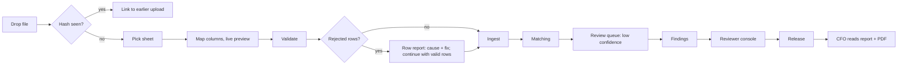
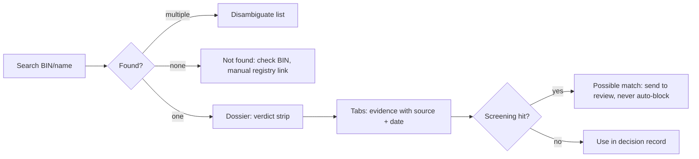

# Information architecture and core journeys

## IA (client app, role-aware)
```text
Home (exceptions + headline numbers)
├─ Spend X-ray
│  ├─ Uploads (list, upload wizard)
│  ├─ Reports (released only for client roles)
│  └─ Items (catalogue, price history)
├─ Suppliers
│  ├─ Directory
│  ├─ Dossier /suppliers/{id}  (verdict, ownership, legal, sanctions, performance, documents, spend)
│  └─ Onboarding (invites, status)
├─ Purchasing
│  ├─ RFQs (list, builder, comparison, decision record)
│  └─ ТЗ checker
├─ Shipments
│  ├─ Exception inbox
│  ├─ All shipments /shipments/{id} (timeline, documents, landed cost, map secondary)
│  └─ Documents
├─ Alerts (Risk Radar)
├─ Ask (global entry, any page)
└─ Settings (org, members, thresholds, consent, language, notifications)
```
Separate apps: `apps/review` (reviewer console), `apps/supplier-portal`, `apps/marketing`. Every screen deep-linkable; Evidence drawer is a URL state (`?evidence=<id>`) so links can be shared in chat.

## Journeys
Each: happy path, then error states. Owner: ui-ux-pro-max. Prototype before build where marked.

### J1. Upload -> report (procurement manager, reviewer, CFO)

Errors: password-protected file; no header; > size limit; currency missing; matcher service down (lines queue, user told when ready); reviewer rejects report (client sees nothing, owner notified).

### J2. Supplier check (procurement manager)

Errors: source down (verdict "incomplete", never "clear"); stale data badge; rate limited (queued refresh).

### J3. RFQ (procurement manager, CFO, supplier)  [prototype comparison screen first]
Draft from template -> internal approval -> **human approves send** -> suppliers respond -> extraction -> **supplier confirms numbers** -> comparison + weights + sensitivity -> decision record -> Order.
Errors: no responses by deadline (remind / extend); offer in other currency (dated FX, shown); missing price (excluded with note); supplier screening hit mid-RFQ (banner, decision blocked until reviewed).

### J4. Track a shipment (coordinator)  [prototype: `prototypes/shipment-timeline.html`]
Exception inbox -> shipment -> timeline of Legs and events with source badges + confidence -> "why we think it's here" -> Evidence -> ETA band.
Errors: conflicting sources (shown, rule explained); stale (no events > N h: "last confirmed ... by ..."); offline (cached view with timestamp).

### J5. Delayed shipment (coordinator, procurement manager)
Delay derived (forecast beyond promise) -> Exception (severity, owner, SLA) -> options: wait / reroute scenario / notify site -> **AI drafts message, human sends** -> outcome logged.
Errors: no reroute data ("no alternatives with enough data"); carrier unreachable; customs hold needs document -> J6-like doc flow.

### J6. Supplier onboarding (supplier rep, buyer)
Invite link -> no-account start -> prefilled company data from registry -> upload docs -> OCR -> **supplier confirms fields** -> screening -> buyer review -> approved / needs info.
Errors: link expired; BIN mismatch; unreadable doc; screening hit (paused, buyer notified, supplier told "additional review", no accusation).
