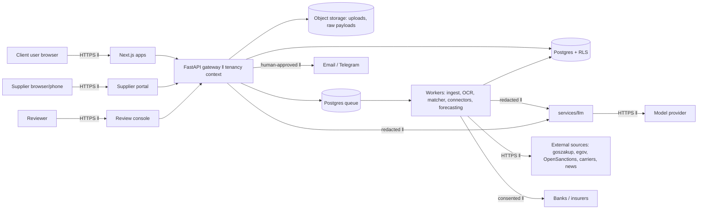

# STRIDE threat model: full architecture (M0 baseline)

Date: 2026-10-08. Scope: the whole planned product (M0-M9), at architecture level. Update at the end of every phase (`senior-security`). DREAD scoring is planned for M9.

## Data flow (trust boundaries marked ‖)

## Threats

| # | STRIDE | Component | Threat | Mitigation (planned phase) | Residual |
|---|---|---|---|---|---|
| T1 | Spoofing | Auth | Stolen session / credential stuffing on client accounts | Supabase Auth, MFA for admins and reviewers (M1), rate limits, short JWT TTL | Medium |
| T2 | Spoofing | Supplier portal | Fake supplier claims another company's BIN | Registry cross-check, buyer approval, ЭЦП signature option (M4/M8) | Medium |
| T3 | Spoofing | Email ingestion | Spoofed offers / carrier updates by email | SPF/DKIM checks, sender allowlists per RFQ, supplier confirmation of extracted numbers (M5/M6) | Medium |
| T4 | Tampering | Findings / Evidence | Figures altered after review | Evidence reproducibility, report versions immutable after release, audit hash chain (M1/M3) | Low |
| T5 | Tampering | ShipmentEvents | Injected or edited events change status | Append-only table + trigger, idempotency keys, source priority rules (ADR 0003, M6) | Low |
| T6 | Tampering | Uploads | Malicious xlsx (macros, zip bombs, formula injection on export) | Reject macro files, size/row limits, parse in sandboxed worker, CSV export escapes `= + - @` (M2) | Medium |
| T7 | Tampering | Supply chain | Compromised npm/PyPI package or GitHub Action | Lockfiles, release-age gate (pnpm), SHA-pinned actions, OSV scan, SBOM, licence gate (M0 done), vendoring policy | Medium |
| T8 | Repudiation | Review / send / award | "I didn't approve that" | Audit log of every human action with user id, version, timestamp, hash chain (M1) | Low |
| T9 | Info disclosure | DB | Cross-tenant read through missing RLS or service-role bug | RLS on every table + pgTAP per policy (M0 baseline done), API-level isolation tests (M1), anon has no grants | Medium |
| T10 | Info disclosure | LLM | Client data sent to model provider; retained or used for training | Redaction in gateway, provider DPA + zero-retention option (UNVERIFIED), per-task minimal context, `llm_calls` without raw content (M1) | Medium |
| T11 | Info disclosure | Logs / evals | PII or prices in logs, traces, eval sets | Structured logging with allowlisted fields, log scan test, synthetic/anonymised eval data only (M1/M2) | Medium |
| T12 | Info disclosure | Shared aggregates | Re-identification of a tenant from price index / group buys | Consent + k-anonymity thresholds, suppression, leak tests (M5/M8) | Medium |
| T13 | Info disclosure | Ask chat | Prompt injection makes the model reveal other data or system prompt | Read-only tenant-scoped tools only, no free SQL, citation enforcement, injection suite (M3) | Medium |
| T14 | Info disclosure | Secrets | API keys in repo or logs | gitleaks pre-commit + CI (M0 done), `.env` never read by agents (settings deny), secret manager in deploy (M1) | Low |
| T15 | Denial of service | Uploads / workers | Huge files exhaust workers | Limits, queue backpressure, per-tenant quotas (M2) | Low |
| T16 | Denial of service | LLM budget | Abuse drives cost | Per-tenant budgets, global cap, kill switch (M1) | Low |
| T17 | Denial of service | Connectors | Source outage stalls pipelines | Degraded states per connector, retries with backoff, DLQ (M4/M6) | Medium |
| T18 | Elevation | Roles | Client user acts as admin / reviewer | Role checks at DB (RLS) + API, role matrix e2e (M1/M9) | Low |
| T19 | Elevation | Agentic features | Model output triggers an action (send, award, block) | Models have no write tools; every external action needs a human approval record (ADR 0004, harness doc) | Low |
| T20 | Elevation | Dev agents (Claude Code) | Agent runs prod migration or reads secrets | `.claude/settings.json` deny list, branch protection, human-controlled surfaces (M0 done) | Low |

## Top 5 to watch
T9 cross-tenant leak, T10 data to model provider, T13 injection via supplier content, T7 supply chain, T6 malicious uploads.

## M1 update (2026-10-08)

Mitigations now implemented and tested:
| Threat | What M1 built | Test |
|---|---|---|
| T9 cross-tenant read/write | RLS on all 19 public tables, role-aware policies, composite `(x_id, org_id)` FKs, explicit grants, anon has nothing | `infra/supabase/tests/m1_rls.test.sql` (data-driven over every org table), API tests `services/gateway/test_api_integration.py`, UI tests `e2e/tests/auth.spec.ts` |
| T4/T8 tampering / repudiation | `audit_log` append-only (trigger, even for owner), sha256 hash chain per org, `private.verify_audit_chain`, actor forced to `auth.uid()` | pgTAP tamper test pinpoints the edited row |
| T1 spoofing | JWT verified against JWKS (ES256), `aud` + `exp` required; tokens only in httpOnly cookies; refresh in `proxy.ts` | forged-signature test -> 401 |
| T11 PII in logs | allowlisted JSON log fields only, no URLs/query strings | `test_log_lines_keep_only_allowlisted_fields` |
| T13/L1 injection via untrusted text | LLM gateway escapes data so it cannot close its `<data>` block; no tools in M1 | `test_untrusted_text_cannot_close_the_data_block` |
| T16 LLM cost abuse | per-tenant monthly budget + kill switch, every attempt in `llm_calls` | gateway tests |

New surface introduced in M1 and its residual risk:
| # | Threat | Mitigation | Residual |
|---|---|---|---|
| T21 | Session theft via XSS | httpOnly cookies; React escapes output; no `dangerouslySetInnerHTML` | Medium until a CSP is set (M3, before first client) |
| T22 | CSRF on server actions (sign-in, sign-out, org switch) | Next validates `Origin` on server actions; `sameSite=lax`; org switch re-checked server-side | Low |
| T23 | Forged `qs_org` cookie | Honoured only if the user is a member; API re-checks membership (404) | Low (tested) |
| T24 | Security-definer helpers (`private.*`) misused | Fixed `search_path=''`, schema not exposed by PostgREST, execute granted to `authenticated` only | Low |
| T25 | Service-role paths (ledger, future pipelines) bypass RLS | Only `PostgresLedger` uses a service connection in M1; every future one needs its own isolation test | Medium |

## M2 update (2026-10-11): spend upload, matching, analysis

Reviewed: `services/ingest`, `services/normalize`, `services/analyze`, `connectors/{enstru,fx}`, `routes_spend.py`, `apps/web/app/spend-actions.ts`, spend UI, migration `20261009000000`.

| # | STRIDE | Threat | Mitigation in M2 | Test | Residual |
|---|---|---|---|---|---|
| T26 | Tampering / DoS | Malicious upload: macro workbook, zip bomb, huge sheet, corrupt file | Macro (vbaProject.bin) and .xls/.xlsm rejected; 25 MB cap enforced while reading; 200k rows / 60 columns caps; openpyxl read-only, values only (formulas never evaluated) | `test_ingest.py`, upload integration + e2e | Medium: decompression size of a crafted .xlsx not capped separately (D19) |
| T27 | Tampering | Formula injection when data is exported back to Excel (`=HYPERLINK`, `@SUM`) | Stored as text; never evaluated server-side | `10_injection.csv` | Medium until CSV/PDF export (M3) escapes `= + - @` |
| T28 | Info disclosure / injection | Prompt injection in item text reaching an LLM | No LLM in the M2 path; future re-rank may only choose among retrieved codes (`test_reranker_cannot_introduce_a_code_outside_the_candidates`); prompts escape `<data>` | matcher + llm tests; e2e shows injected text inert | Low now; re-assess when the Anthropic adapter lands (D11) |
| T29 | XSS | Script in a supplier name rendered in review UI | React escaping; nonce CSP; no dangerouslySetInnerHTML | e2e: `<script>` text visible, no dialog, no script element contains it | Low |
| T30 | Elevation | Client writes findings or runs analysis to fabricate savings | Analysis endpoint staff-only and findings/evidence insert policies staff-only under RLS (no service-role bypass) | pgTAP m2 (client cannot write evidence), API 403, e2e no button | Low |
| T31 | Tampering | Wrong money from a bug in one implementation | Every run recomputes price-variance and outlier savings in independent exact-numeric SQL; any mismatch aborts before writing | `cross_check`, end-to-end integration | Medium: repeat/split/concentration not double-implemented (D16) |
| T32 | Repudiation | Reviewer denies a match decision | `match_feedback` append-only, reviewer forced to `auth.uid()`; uploads and analysis write audit entries | pgTAP m2, integration | Low |
| T33 | Tampering | Raw purchase values edited to change findings | Column grants allow only match fields to be updated; raw/price/date immutable for users | pgTAP m2 | Low |
| T34 | Info disclosure | Cross-tenant review or evidence access by id | Line lookup scoped by org + RLS; 404 for foreign ids | integration `test_cannot_review_another_tenants_line` | Low |
| T35 | DoS | Upload via server action floods memory | 26 MB action body cap; API re-checks 25 MB | e2e macro/size paths | Low |
| T36 | Supply chain | New deps (rapidfuzz, openpyxl, hypothesis, python-multipart) | Exact pins >= 14 days old; licence gate; OSV in CI | license_check, security-scan | Low |
| T37 | Tampering | Hostile XML from the FX source (XXE / entity expansion) | DOCTYPE/ENTITY refused, 256 KB cap, no network in tests | `test_hostile_xml_is_refused` | Low |
| T38 | Integrity | Controlled purge abused to erase audit history | DELETE-only, privileged roles only, inside a `qs.purge` transaction; UPDATE never allowed; runbook + owner approval | pgTAP m2 purge tests | Medium (privileged access is trusted by design) |

## M3 update (2026-10-12): review gate, client report + PDF, Ask

New boundaries: the reviewer console writes the release decision; a model provider (development: OpenRouter free endpoints, synthetic data only; production: Claude, D11) receives finding-level data from Ask.

| # | STRIDE | Threat | Mitigation | Test | Residual |
|---|---|---|---|---|---|
| T39 | Elevation | Staff (or a bug) releases a report without review, or edits findings after review | DB trigger state machine: release only from `approved`; approval needs a decision on every finding + a signed approval; findings frozen after draft; API 403/409; UI shows only allowed steps | pgTAP `m3_review_gate` (44), integration `test_review_integration`, e2e review journey | Low (privileged DB roles bypass by design) |
| T40 | Repudiation | A reviewer denies approving or releasing | Audit entries written by the DB trigger itself (hash-chained); `released_by` stamped from `auth.uid()`; reviews append-only, `clock_timestamp()` ordered | pgTAP audit counts; "released_by is the caller" | Low |
| T41 | Info disclosure | Client sees a rejected finding, its evidence or the reviewer's internal note | `finding_visible` (latest decision not `reject`) on findings, evidence and reviews policies | pgTAP client checks; e2e "One-off emergency order" absent | Low |
| T42 | Info disclosure | `staff_name` used to enumerate users' names | Answers only for staff of an org the caller belongs to; never emails | pgTAP reviewer-name checks | Low |
| T43 | Info disclosure | Unreleased report leaked via the PDF URL | PDF built from the same API calls: client gets 404 until release | e2e PDF 404 before release | Low |
| T44 | Tampering (prompt injection) | Supplier names, file cells, chat or history steer Ask to show false figures, links or the rules | No tools (untrusted text never gets tool access); data escaped in `<data>`; server validator drops unbacked numbers, unknown citations, links/emails, rule leaks, poisoned names | `evals/ask` obedient gate: 0/56 structural hijacks; validator unit + property tests | **Medium: text-only hijacks (no digits, no link) depend on the model; measured live** |
| T45 | Info disclosure (third party) | Tenant data sent to a model provider | Opt-in per org (`ask_enabled`, admins only); findings-level fields only; no ids/BINs (F-refs), redaction; dev providers refused unless the DB is local | integration "no UUID in prompt", `test_llm_provider_choice` | Medium until a DPA with the production provider exists |
| T46 | DoS / cost | Ask used to burn the AI budget | Monthly per-org budget + kill switch before every call; ledger on a service connection that commits even when blocked | integration kill-switch test | Low |
| T47 | Spoofing | Client admin disables QazSupply's two-person rule | `four_eyes` changeable only by a QazSupply admin (DB trigger, 403) | pgTAP + integration settings test | Low |

## M4 update (2026-10-12): Supplier 360, screening, onboarding

New boundaries: ‖ supplier user (role `supplier`) ‖ onboarding case of its own; ‖ supplier-uploaded documents ‖ (untrusted files); ‖ external registries and lists ‖ (sample adapters in M4, typed failures); concurrent writers on shared per-org resources (audit chain, supplier resolution).

| # | STRIDE | Threat | Mitigation | Test | Residual |
|---|---|---|---|---|---|
| T48 | Spoofing / Elevation | A supplier user reads buyer data (spend, dossiers, other suppliers' cases) | `supplier` is not a reader in any policy; onboarding rows visible only to `supplier_user_id = auth.uid()`; pages 404 | pgTAP m4 "supplier sees no dossier data", m4_onboarding "sees only its own case"; e2e supplier gets 404 on a dossier | Low |
| T49 | Tampering | A supplier approves its own onboarding, or a buyer rewrites the supplier's declared data | DB state machine (`guard_onboarding`): supplier transitions only invited/in_progress/submitted; buyer only decides from submitted; supplier data immutable for buyers; decided_by = auth.uid() | pgTAP m4_onboarding (20 checks); integration test | Low |
| T50 | Tampering (malicious file) | A supplier uploads an executable or script disguised as a document; a buyer opens it inline | Type by magic bytes (PDF/PNG/JPEG only), 5 MB cap in API and DB, append-only, served only as `attachment` with `nosniff` and `sandbox` CSP through the proxy route | integration "unsupported_file_type", download headers; e2e exe refused, download is an attachment | Medium: a malicious but valid PDF can still exploit a viewer on the buyer's machine; AV scanning not built (D30) |
| T51 | Repudiation | "Nobody confirmed that sanctions hit" / "who approved this supplier?" | Hit decisions and onboarding transitions append-only and audited by DB trigger with the deciding user; reason codes mandatory | pgTAP audit actor checks | Low |
| T52 | Info disclosure (personal data) | Beneficial owners' data over-collected or browsed without trace | Persons store name, country, birth year only (DB check: no IIN/BIN for persons); every dossier view writes `dossier.viewed` with the persons count | pgTAP "a person never carries a BIN/IIN"; integration dossier read | Medium: retention period for cached registry data not yet set by counsel (D33) |
| T53 | Spoofing (identity) | A sanctioned party is missed because its name is written in another script or with a patronymic form | Explainable skeleton matcher (kk/ru/en/Kazakh Latin, patronymic folding), recall-first threshold; hits never auto-block, a human decides | `evals/screening` gate: recall 1.0 on 51 positives, 0 FP on 25 negatives | **Medium: synthetic set built by us; real names and the licensed list may behave differently** |
| T54 | DoS / integrity | A registry outage or schema change silently produces an empty dossier that looks "clean" | Typed `SourceUnavailable` (down, rate_limited, schema_drift); verdict `unknown` when not built or never screened (never `ok`); outage shown as an alert | connector contract tests per failure; e2e outage state; risk unit test "unknown is never ok" | Low |
| T55 | Tampering (race) | Concurrent writes break the audit hash chain or duplicate suppliers | Chain trigger takes the per-org lock before drawing the id; supplier resolution under a per-org transaction lock; upload handlers run in the threadpool (no event-loop deadlock) | `test_audit_chain_integration` (not yet run locally, see PROGRESS), supplier race test red 3-4 dupes -> green, concurrent-upload test | Low after the audit test runs |
| T56 | Tampering (prompt injection) | Supplier names, registry text or uploaded documents steer a model | No model reads any M4 data (no AI summary, no OCR); screening and scoring are rules + SQL | n/a until an AI summary or OCR is added (D31, D29): then add the documents to `evals/ask`-style injection suites | Low now |
