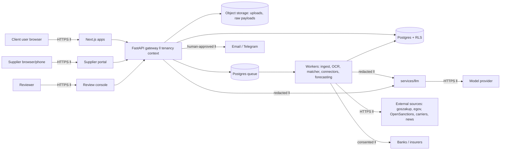

# STRIDE threat model: full architecture (M0 baseline)

Date: 2026-10-08. Scope: the whole planned product (M0-M9), at architecture level. Update at the end of every phase (`senior-security`). DREAD scoring is planned for M9.

## Data flow (trust boundaries marked ‖)

## Threats

| # | STRIDE | Component | Threat | Mitigation (planned phase) | Residual |
|---|---|---|---|---|---|
| T1 | Spoofing | Auth | Stolen session / credential stuffing on client accounts | Supabase Auth, MFA for admins and reviewers (M1), rate limits, short JWT TTL | Medium |
| T2 | Spoofing | Supplier portal | Fake supplier claims another company's BIN | Registry cross-check, buyer approval, ЭЦП signature option (M4/M8) | Medium |
| T3 | Spoofing | Email ingestion | Spoofed offers / carrier updates by email | SPF/DKIM checks, sender allowlists per RFQ, supplier confirmation of extracted numbers (M5/M6) | Medium |
| T4 | Tampering | Findings / Evidence | Figures altered after review | Evidence reproducibility, report versions immutable after release, audit hash chain (M1/M3) | Low |
| T5 | Tampering | ShipmentEvents | Injected or edited events change status | Append-only table + trigger, idempotency keys, source priority rules (ADR 0003, M6) | Low |
| T6 | Tampering | Uploads | Malicious xlsx (macros, zip bombs, formula injection on export) | Reject macro files, size/row limits, parse in sandboxed worker, CSV export escapes `= + - @` (M2) | Medium |
| T7 | Tampering | Supply chain | Compromised npm/PyPI package or GitHub Action | Lockfiles, release-age gate (pnpm), SHA-pinned actions, OSV scan, SBOM, licence gate (M0 done), vendoring policy | Medium |
| T8 | Repudiation | Review / send / award | "I didn't approve that" | Audit log of every human action with user id, version, timestamp, hash chain (M1) | Low |
| T9 | Info disclosure | DB | Cross-tenant read through missing RLS or service-role bug | RLS on every table + pgTAP per policy (M0 baseline done), API-level isolation tests (M1), anon has no grants | Medium |
| T10 | Info disclosure | LLM | Client data sent to model provider; retained or used for training | Redaction in gateway, provider DPA + zero-retention option (UNVERIFIED), per-task minimal context, `llm_calls` without raw content (M1) | Medium |
| T11 | Info disclosure | Logs / evals | PII or prices in logs, traces, eval sets | Structured logging with allowlisted fields, log scan test, synthetic/anonymised eval data only (M1/M2) | Medium |
| T12 | Info disclosure | Shared aggregates | Re-identification of a tenant from price index / group buys | Consent + k-anonymity thresholds, suppression, leak tests (M5/M8) | Medium |
| T13 | Info disclosure | Ask chat | Prompt injection makes the model reveal other data or system prompt | Read-only tenant-scoped tools only, no free SQL, citation enforcement, injection suite (M3) | Medium |
| T14 | Info disclosure | Secrets | API keys in repo or logs | gitleaks pre-commit + CI (M0 done), `.env` never read by agents (settings deny), secret manager in deploy (M1) | Low |
| T15 | Denial of service | Uploads / workers | Huge files exhaust workers | Limits, queue backpressure, per-tenant quotas (M2) | Low |
| T16 | Denial of service | LLM budget | Abuse drives cost | Per-tenant budgets, global cap, kill switch (M1) | Low |
| T17 | Denial of service | Connectors | Source outage stalls pipelines | Degraded states per connector, retries with backoff, DLQ (M4/M6) | Medium |
| T18 | Elevation | Roles | Client user acts as admin / reviewer | Role checks at DB (RLS) + API, role matrix e2e (M1/M9) | Low |
| T19 | Elevation | Agentic features | Model output triggers an action (send, award, block) | Models have no write tools; every external action needs a human approval record (ADR 0004, harness doc) | Low |
| T20 | Elevation | Dev agents (Claude Code) | Agent runs prod migration or reads secrets | `.claude/settings.json` deny list, branch protection, human-controlled surfaces (M0 done) | Low |

## Top 5 to watch
T9 cross-tenant leak, T10 data to model provider, T13 injection via supplier content, T7 supply chain, T6 malicious uploads.

## M1 update (2026-10-08)

Mitigations now implemented and tested:
| Threat | What M1 built | Test |
|---|---|---|
| T9 cross-tenant read/write | RLS on all 19 public tables, role-aware policies, composite `(x_id, org_id)` FKs, explicit grants, anon has nothing | `infra/supabase/tests/m1_rls.test.sql` (data-driven over every org table), API tests `services/gateway/test_api_integration.py`, UI tests `e2e/tests/auth.spec.ts` |
| T4/T8 tampering / repudiation | `audit_log` append-only (trigger, even for owner), sha256 hash chain per org, `private.verify_audit_chain`, actor forced to `auth.uid()` | pgTAP tamper test pinpoints the edited row |
| T1 spoofing | JWT verified against JWKS (ES256), `aud` + `exp` required; tokens only in httpOnly cookies; refresh in `proxy.ts` | forged-signature test -> 401 |
| T11 PII in logs | allowlisted JSON log fields only, no URLs/query strings | `test_log_lines_keep_only_allowlisted_fields` |
| T13/L1 injection via untrusted text | LLM gateway escapes data so it cannot close its `<data>` block; no tools in M1 | `test_untrusted_text_cannot_close_the_data_block` |
| T16 LLM cost abuse | per-tenant monthly budget + kill switch, every attempt in `llm_calls` | gateway tests |

New surface introduced in M1 and its residual risk:
| # | Threat | Mitigation | Residual |
|---|---|---|---|
| T21 | Session theft via XSS | httpOnly cookies; React escapes output; no `dangerouslySetInnerHTML` | Medium until a CSP is set (M3, before first client) |
| T22 | CSRF on server actions (sign-in, sign-out, org switch) | Next validates `Origin` on server actions; `sameSite=lax`; org switch re-checked server-side | Low |
| T23 | Forged `qs_org` cookie | Honoured only if the user is a member; API re-checks membership (404) | Low (tested) |
| T24 | Security-definer helpers (`private.*`) misused | Fixed `search_path=''`, schema not exposed by PostgREST, execute granted to `authenticated` only | Low |
| T25 | Service-role paths (ledger, future pipelines) bypass RLS | Only `PostgresLedger` uses a service connection in M1; every future one needs its own isolation test | Medium |
